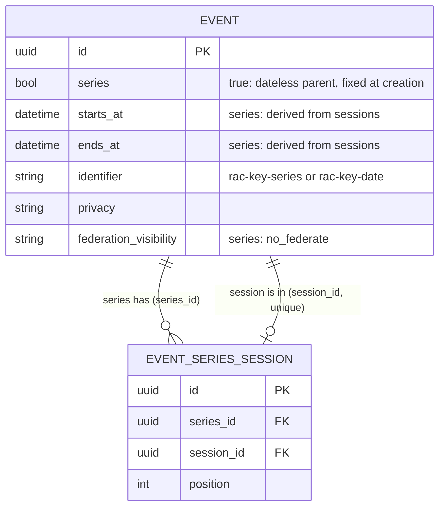
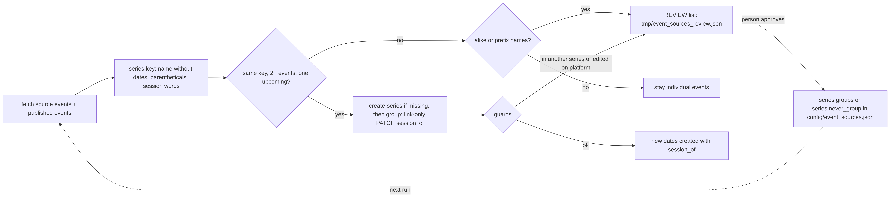

# Event series and sessions

Status: built and deployed to NLO production (migrations applied). No series exist in production until the first
ingest run that finds a group.

## What it is

A ticketed run of dates, such as A Tribute to Fleetwood Mac on Nov 28 and Nov 29, is:

- one **series**: a parent event with no dates of its own, shown as a mention on its sessions' cards and as a page that
  lists its sessions;
- several **sessions**: full events (own page, hosts, RSVP, comments, ICS, categories, location, cover, registration
  url, status) that appear in event lists and say they belong to the series.

Series are separate from CE recurrence. Recurrence is "every Tuesday" (one page, computed dates). A series is "each
night has its own poster and ticket link" (a real event per date). A session may itself recur.

## Model

Source: `diagrams/source/nlo_event_series_model.mmd`.

- `better_together_events.series` boolean, default false, set at creation and never changed.
- `better_together_event_series_sessions` joins a series to its sessions; a session is in one series (unique index).
  Same-day sessions are fine.
- The series has no authored dates. Its span is derived from its non-cancelled sessions. A series forces
  `federation_visibility` to `no_federate`; sessions federate as ordinary events.
- Code: `app/models/concerns/better_together/event_series.rb` (join, validations, `session_of`),
  `event_series_map.rb` (keeps series off the events map), `app/controllers/concerns/better_together/event_series_actions.rb` (controller choices).

### Cancelling or deleting a series

Neither action touches sessions silently. The person chooses to cancel or delete the upcoming sessions, or to promote
them to standalone events. Past sessions are never changed. The API requires a `sessions` choice (`cancel`, `delete`,
`promote`) and answers 422 without it.

## Surfaces

| Surface | Series | Session |
| --- | --- | --- |
| Event lists, settlement and community tabs, map | Hidden | Shown, with a "Part of <series>" mention |
| Event page | Derived date range, session cards, no RSVP | Normal page plus a banner linking to the series |
| Sitemap | Included (public events) | Included |
| JSON:API | Returned with `series: true` | Returned with read-only `series_identifier` |

The map filter is a prepend on `EventCollectionMap.records` (initializer `better_together_models.rb`).

## API

JSON:API on `Event`, with `Accept` and `Content-Type: application/vnd.api+json`. The actor must have accepted the
content publishing agreement.

- `series` (boolean, create only): creates a series.
- `session_of` (series identifier): on create, links the new event to that series. On update, links an existing event
  that is in no series. It never copies defaults on update.
- `series_identifier` (read only).

## Ingester

Code: `scripts/event_source_publish.py` and `scripts/event_series_grouping.py` in the management-tool repo.

Source: `diagrams/source/nlo_event_series_ingest_flow.mmd`.

- Grouping is re-evaluated every run over fetched and already published events, so a date that appears months later
  still joins, and an event first published alone is converted in place (identifier, slug and cover are kept).
- The series key is the slug of the name with parentheticals, trailing dates and session words removed. Same key means
  automatic grouping. The series identifier is `<prefix>-<key>-series`.
- Alike or prefix names (similarity 0.85, or a prefix of at least 8 characters) are listed for review in
  `tmp/event_sources_review.json` and printed as `REVIEW`. Approve with `series.groups` (source event ids) or keep apart
  with `series.never_group` in `config/event_sources.json`.
- Op order: `create-series`, `group` (link-only PATCH), then create, update and unpublish.
- Guards: a group needs one upcoming event; an event in another series is never moved; an event edited on the platform
  is not converted; nothing is ungrouped or deleted; a series goes private when all its sessions are private.

## Deployment

Release runs `rails db:migrate`. Deploy follows the usual NLO T3 path (push, Dokku remote). After a deploy, confirm no
stale `upcoming` containers and check `GIT_REV`.

## Open items

- Propose `series` and the sessions join as CE gem features (the point at which series federation can be revisited).
- The `event_series` edit form still allows status cancelled on a series.
