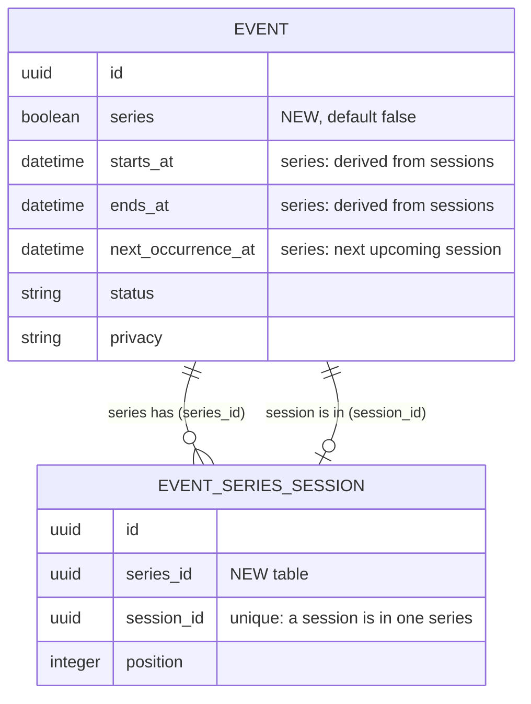

# Event series and sessions: design (DRAFT, nothing built)

Status: proposal for review. The earlier "sessions as cards on one recurring event" build (local commits 3b7bc57 and
7509369, never pushed) is superseded by this model and would be reworked.

## Goal

A ticketed run of dates, such as A Tribute to Fleetwood Mac on Nov 28 and Nov 29, is modelled as:

- one **series**: a parent event with no dates of its own, shown only as a mention on its sessions' cards, and as a page
  that lists its sessions;
- several **sessions**: full events (own page, hosts, RSVP, invitations, comments, ICS, categories, location, cover,
  registration url, status, federation) that appear in the event list and say they belong to the series.

## Series versus CE recurrence: two different jobs

| | CE recurrence (exists) | Series and sessions (new) |
| --- | --- | --- |
| Idea | One thing that repeats by a rule | A group of distinct events under one umbrella |
| Examples | Tuesday yoga, monthly open mic, weekly board meeting | A play's run, a tour, a festival, a course with a different topic each week |
| Dates | Computed from an iCal rule; irregular dates need exceptions | Any dates, regular or not |
| Record per date | None until someone overrides it (a lazy row for cancel, time or RSVP) | A real event per date, always |
| Page and URL | One page for all dates | One page per date, plus one page for the run |
| Own cover, tickets, hosts, RSVP, comments per date | No (shared, with a few overrides) | Yes, all of it |
| In the event list | One card showing the next date | One card per session, each marked as part of the series |
| Rule of thumb | "Every Tuesday" | "Each night has its own poster and ticket link" |

They stay separate and complementary. A session may itself be a recurring event (a weekly class that is one session of
a term series). Later, a "generate sessions from a rule" action can bridge them: a rule that needs per-date pages is
expanded once into sessions, which then evolve independently.

## Model

### Link: a join table, not CE's occurrence table

Decision (revised after the recurrence comparison): use a new `event_series_sessions` table.

CE's `event_occurrences` row means "one computed date of a rule, with optional overrides". Reusing it for sessions would
make one table mean two things and force three workarounds in CE's own constraints: a partial unique index on
(event, date) so same-day sessions can coexist, a skipped "date matches the schedule" validation, and a nullable column
that is meaningless for every rule-based row. It would also block a session from being a recurring event. A join table
has none of that, touches no CE table, and cannot collide with CE upstream. Session attendance and comments already live
on the session event itself, so nothing is lost by not using `event_occurrence_id`.

| Change | Where | Notes |
| --- | --- | --- |
| `better_together_events.series` boolean, not null, default false, indexed | NLO migration | The only "type" flag. A session is an event with a row in the join table. |
| `event_series_sessions`: `series_id` FK, `session_id` FK, `position`; unique index on `session_id`; index on `series_id` | NLO migration (guarded, `create_table` only if missing) | A session belongs to one series. Same-day sessions are fine. |

A series may not have a recurrence rule of its own (validated). All migrations are additive and guarded.

### Derived series dates

The series has no authored start or end. `starts_at`, `ends_at`, `duration_minutes` and `next_occurrence_at` on the series
row are a **cache computed from its non-cancelled sessions** (first start, last end, next upcoming start), refreshed by an
after-commit hook on session create, update, destroy and link changes, with `update_columns` as CE does for
`next_occurrence_at`. They are read-only in the form and the API. Keeping them filled lets CE's own scopes, its
"anonymous viewers need a start time" visibility rule and the date display on the series page work unchanged. A series
with no sessions yet has no dates and is a draft.

### Rules

- **Series**: `series = true`, has hosts, name, description, cover, privacy, status, categories. No RSVP, no invitations,
  no attendance, and no add-to-calendar of its own: only sessions can be added to a calendar.
- **Session**: ordinary event. Created with the series' hosts, privacy, categories and description copied in, each of
  which the session may then change on its own. Own cover and registration url (Eventbrite's per-night image and ticket
  page). Name defaults to the series name and may differ (a guest night); a card or banner shows both names only when
  they differ.
- **Identifiers**: series `rac-a-tribute-to-fleetwood-mac`; sessions `rac-a-tribute-to-fleetwood-mac-2026-11-28`.

### Cancelling or deleting a series (decided)

Neither action touches the sessions silently. The person must choose what happens to them, and the action does not run
until they do.

| Action | Choices for the sessions | Notes |
| --- | --- | --- |
| Cancel the series | Cancel all upcoming sessions, or promote them to standalone events (unlink; they stay as they are) | Past sessions are never changed. |
| Delete the series | Delete all sessions, or promote them to standalone events | Promoted sessions keep their page, RSVPs and history. |

- The web form shows a confirmation panel with the session count, the list of affected sessions and the choices, none
  preselected. Deleting sessions needs the same extra confirmation as deleting any event with attendees.
- The API takes a required `sessions` choice (`cancel`, `delete` or `promote`) on those requests and answers 422 without
  it, so automation cannot cancel or delete a series by accident.
- Each choice is written to the audit trail with the sessions it affected, and one session's failure rolls the whole
  action back.
- Cancelling or deleting one session never touches the series or its siblings; the derived dates refresh.

## Behaviour

| Surface | Series | Session |
| --- | --- | --- |
| Event list (`/events`), community and settlement event tabs, map | Hidden | Shown, with a "Part of <series>" mention on the card |
| Event page | Header uses the series cover and derived date range; sessions listed as event cards between the description and the hosts; no RSVP | Normal event page plus a "Part of <series>" banner linking to the series and the sibling sessions |
| Direct URL, edit, hosts' dashboard | Reachable by visibility rules; editable by hosts | Normal |
| JSON:API list | Returned (flag `series` in the resource) so the ingester can find it | Returned, with its series |
| Sitemap, search | Series indexed (it is the page for the run); sessions indexed | |

The list exclusion is one seam: a prepend on `EventPolicy::Scope#resolve` adding `where(series: false)`. The JSON:API
list uses `permitted_query` directly, so it is not affected. The card mention is a host copy of `_event.html.erb` (or a
hook inside it) whose cache key also includes the series' `updated_at`.

## Federation (decided)

The series keeps `federation_visibility` private until the feature is backported to CE and built out there. Sessions
federate as ordinary events. The series row is never sent to peers, so no peer sees a dateless event.

## API and ingester

- Event resource, write-only: `series` (boolean, create only) and `session_of` (the series identifier, create only).
  Creating a session with `session_of` makes the join row in the same save and copies the series defaults.
- Replaces the `recurrence_spec` and `occurrence_specs` JSON fields from the superseded build (removed).
- Ingester: listings with the same normalised name at the same venue, two or more, become one series plus one session per
  listing. A lone listing stays a standalone event. State rows record the series and each session by source id, so reruns
  create nothing twice. A listing that leaves the source cancels its session (never deletes). A standalone event that
  later gains a sibling is adopted as a session by an explicit `--adopt` run, not silently.

## Phases (each ends in a review gate)

1. Model: migrations, join table, derived dates, list exclusion, series cancel and delete choices (model and API),
   specs, local data. Deliver a local URL.
2. Views: session card mention, series page with session cards, session banner, cancel and delete confirmation panel,
   screenshots.
3. API and ingester grouping, state handling, dry run output for review.
4. Community and settlement tabs, sitemap, Mermaid diagram export, docs, then a CE upstream PR
   proposing `series` and the sessions join as gem features (the point at which series federation can be revisited).

## Decided

- A session's name may differ from the series name; both are shown only when they differ.
- The series has no add-to-calendar and no ICS feed; each session has its own.
