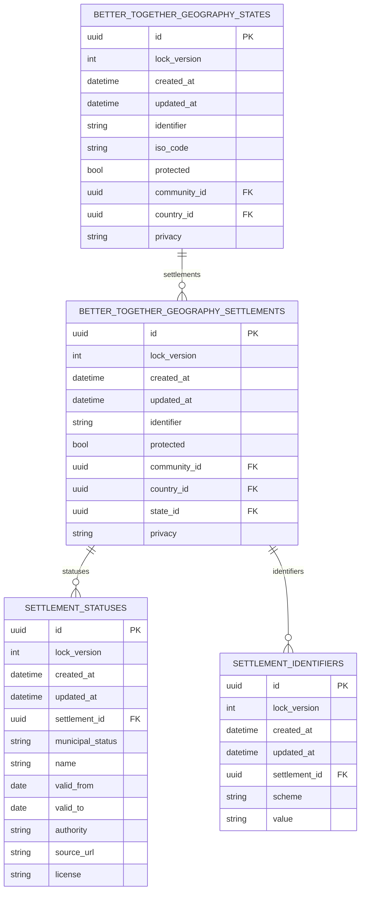

# Municipal settlements: status and identifiers

Phase 1 of the municipal data work (plan: management-tool `~/.claude/plans/nlo-municipal-data-plan.md`, source
findings in `tmp/municipal/phase0-findings.md`). A settlement is the single record for a place. Municipal standing and
outside ids hang off it, so a town that was an unincorporated community, became a town and later amalgamated is one
record with a dated history.



## Dated status

Both tables and models use the Community Engine naming (`better_together_geography_*`, `BetterTogether::Geography::*`,
created with `create_bt_table`), so they can move into the gem unchanged. Only the concern that attaches them to
`Settlement` is host-side.

`BetterTogether::Geography::SettlementStatus` (`better_together_geography_settlement_statuses`) records the standing a settlement held over a date range, with the authority
and source that say so.

| Field | Meaning |
|---|---|
| `municipal_status` | `city`, `town`, `inuit_community_government`, `local_service_district`, `reserve`, `unincorporated` |
| `name` | The name used under this status, when it differs from the settlement's current name |
| `valid_from`, `valid_to` | Dates in force. An empty end means current. An empty start means "not recorded" |
| `authority`, `source_url`, `license` | Who says so and under what licence the record was taken |

`settlement.status_on(date)` and `settlement.current_status` resolve the status in force. When ranges overlap, the one
with the latest `valid_from` wins.

## Identifiers

`BetterTogether::Geography::SettlementIdentifier` (`better_together_geography_settlement_identifiers`) holds external ids, unique per scheme and value, one per scheme per
settlement: `statcan_csd`, `statcan_dguid`, `nl_open_data_gcl`, `wikidata`, `osm_relation`.
`Settlement.with_identifier(scheme, value)` finds a settlement by any of them.

## Boundaries

Settlements keep their boundary on the geography space, with `boundary_source` provenance and the credit described in
`settlement-map.md`. The OSM/Nominatim boundary already stored is the default. Statistics Canada census subdivision
and city GIS boundaries are a follow-up; they will be recorded as a differently sourced boundary, never overwriting a
sourced one without a flag. Open Data NL dataset 265 holds points only, so it supplies names and ids, not shapes.

## Councils and officials (phase 2)

A council is a `LegislatureCommunity` whose `LegislatureDetail` has level `municipal`, the settlement as jurisdiction
and a `body_kind`: `council`, `lsd_committee` (elected local service district committee, no council powers) or
`legislature` (the default, for the House of Assembly). Councils are civic communities, so they stay out of generic
discovery and the sitemap like other civic types.

Offices use the generic legislature roles: `legislature_head` (title "Mayor" or "Chair"), `legislature_deputy_head`
(title "Deputy Mayor") and `legislature_member` (title "Councillor", "Ward 3 Councillor"). A deputy mayor holds both the
deputy role and a councillor role. Wards are `CommunitySeat` records; at-large councillors have no seat.

`Civic::MunicipalCouncil` provisions a council and its seats. `Civic::MunicipalRosterLoader` reads
`db/data/nl_municipal/councils.json` and creates people (one per settlement and name, identifier
`nl-municipal-<settlement>-<name>`) and dated memberships. It also records the settlement's Statistics Canada CSD code
and municipal status. Only names, offices and dates are loaded; no phone numbers or emails.

```bash
bin/dc-run bin/rails nlo:municipal:load_councils            # dry run, rolled back
APPLY=1 bin/dc-run bin/rails nlo:municipal:load_councils    # writes
```

The packet holds Corner Brook (council page, results of 2025-10-02) and St. John's (the city's own council page,
fetched 2026-11-01). Start dates are the election date and approximate (St. John's 2025-10-08). A person who is both a councillor and
an MHA has two records for now.

## Municipal elections (phase 3)

The provincial election tables now also hold council contests (diagram: `nlo_elections_schema_erd`).

- `elections` gains `community_id` (the council) and `kind` (general, by_election, plebiscite). Uniqueness is per
  jurisdiction, state, council and date.
- `electoral_contests` gains `office` (member, mayor, deputy_mayor, councillor), `seats_available` and `community_seat_id`;
  `region_id` is optional for municipal contests, which are unique per election, office and seat.
- `candidacies` gain `acclaimed`; `party_name` and `votes` are optional for municipal candidates (no NL council has
  parties; acclaimed candidates have no votes).
- A contest has `winners` (several for a multi-seat councillor race) and a nil-safe `total_votes`.
- Municipal elections are excluded from the public provincial elections pages, which assume a region per contest.

`MunicipalElectionLoader` reads `db/data/nl_municipal/elections.json`, finds the council by settlement, writes the
election, contests and candidacies, and links each elected candidate to the matching office through
`conferred_by` on the mandate. Elected candidates with no matching office are reported, not guessed.

```bash
bin/dc-run bin/rails nlo:municipal:load_elections            # dry run
APPLY=1 bin/dc-run bin/rails nlo:municipal:load_elections    # writes
```

The packet holds Corner Brook 2025-10-02 (source: cornerbrookvotes.com) and St. John's 2025-10-08 (source: the city's
published results, with votes per candidate). Load councils first. Contests use the offices `mayor`, `deputy_mayor`
and `councillor`; each elected candidate is linked to the matching office through `conferred_by`, and the roster's
`source_url` is stored on each mandate.

## Municipality pages

Public pages live under the electoral routes (`/e/`):

| Route | Page |
|---|---|
| `/e/municipalities` and `/e/municipalities/:province` | Directory of municipalities with a council |
| `/e/municipalities/:province/:settlement` | Facts, mayor, deputy mayor, councillors, latest election |
| `/e/elections/municipal/:province/:settlement/:year` | Full contest results for one election |

The settlement page also shows a "Municipal government" card linking to its municipality page. Data is read through
`Civic::Municipality` (current offices come from time-boxed memberships). Start dates equal the election date unless
the source gives a swearing-in date, and the page says so. Meetings are not shown until phase 3b.

Stable ids for DOM contracts: `municipalities-list`, `municipality-page`, `municipality-leaders`, `council-members`,
`council-source`, `municipality-election`, `municipal-election-page`, `election-date`, `election-source`,
`settlement-municipal-card`. Contracts: `spec/dom_contracts/municipality_pages_spec.rb`; screenshots:
`spec/docs_screenshots/municipalities_spec.rb` (output in `docs/screenshots/`).

## Ward boundaries

Ward polygons hang off the council's `CommunitySeat` through `seat_boundaries` (one current boundary per seat, with
`authority`, `source_url`, `portal_url`, `license`, `source_sha256`, `fetched_on` and a computed `area_km2`; diagram:
`nlo_civic_roles_schema_erd`).

St. John's publishes its wards on a public ArcGIS layer. The service states no licence, vintage or credit (its metadata
is unfilled template text), so the packet records `license: null` and the boundary is credited to the City with a link
to its download portal, so a viewer can get the data themselves. `BoundaryCredit.for_seat_boundary` builds that line
("Boundary: City of St. John's", linked to `portal_url`).

```bash
bin/dc-run env WRITE=1 bin/rails nlo:municipal:fetch_ward_packet   # downloads WGS84 GeoJSON, read-only against the City
bin/dc-run bin/rails nlo:municipal:load_ward_boundaries            # dry run
APPLY=1 bin/dc-run bin/rails nlo:municipal:load_ward_boundaries    # writes (load councils first)
```

The packet is `db/data/nl_municipal/st_johns_wards.geojson` (fetched 2026-11-01, five wards, checksum recorded). The
five ward areas sum to 478.85 km2, matching the City Boundary layer (478.77 km2). The layer's only population field is
`POP2001`, so the wards may predate the current by-law; compare with the by-law before relying on them for 2025. The municipality page draws the wards (id `municipality-ward-map`) between the leadership box and the councillors table
once boundaries are loaded: one coloured, clickable area per ward (name and councillor in the popup), credited in the map
attribution and in a source line (`ward-map-source`) that links the City's download portal.

## Not in this phase

Bylaws, meetings and census data follow in later phases.
