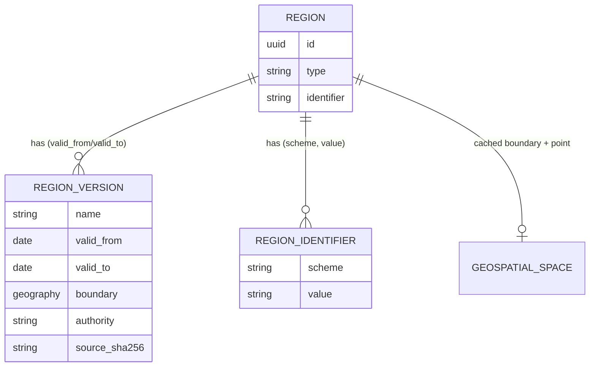

# Typed regions, versions and identifiers

Host-side first cut (to be backported to Community Engine). Plan and data sources: management-tool
`docs/nl-regions-electoral-census-assessment-20261019.md`.

- `Region` keeps one identity across redistributions. `NewfoundlandLabradorOnline::ProvincialElectoralDistrict` is an STI
  subtype (identifier `nl-ped-<slug>`).
- `RegionVersion` (`region_versions`) stores the name and boundary in force over a date range. `region.version_on(date)`
  and `region.current_version` resolve it. The region's `Space#boundary` caches the current version for placement.
- `RegionIdentifier` (`region_identifiers`) holds external ids, unique per scheme (`nlo_ped`, `statcan_dguid`,
  `statcan_feduid`, `wikidata`, `osm_relation`, `elections_nl`).

## Loading the 40 districts (2015 map)

`bin/rails nlo:regions:load_provincial_districts` reads `db/data/nl_regions/provincial_electoral_districts_2015.geojson`
(Open Data NL dataset 361, Open Government Licence; simplified to about 70 m). Idempotent: districts match on their
`nlo_ped` identifier, and a version's boundary is rewritten only when the packet's `source_sha256` changes.

The packet is built by management-tool `scripts/nl_regions_ingest.py` (`fetch-districts`, `build-districts`).
