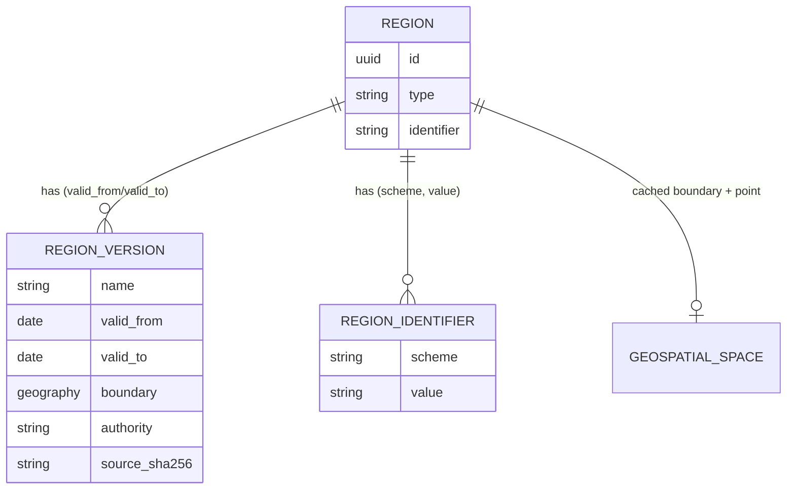
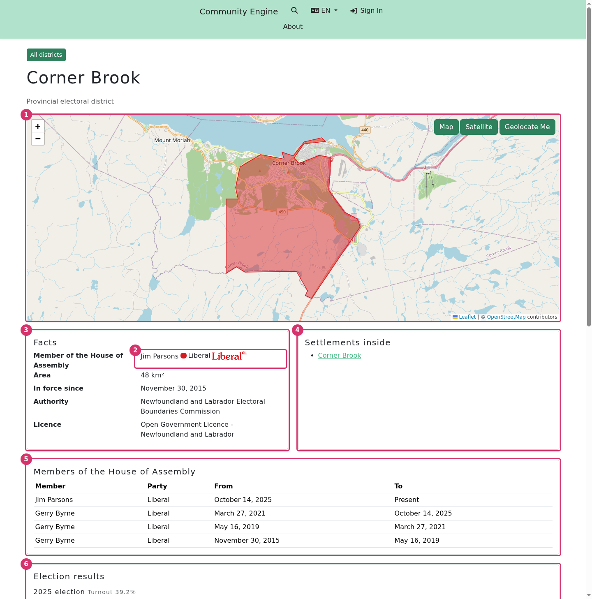
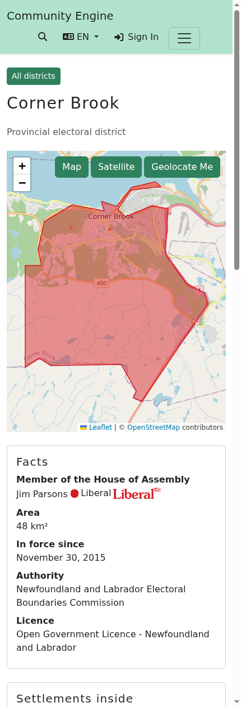
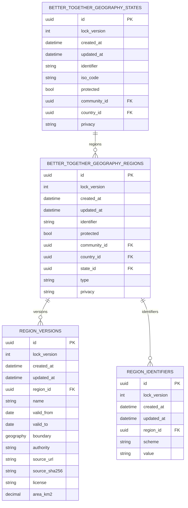
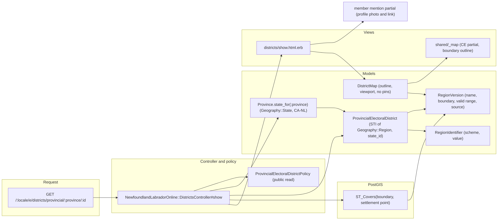
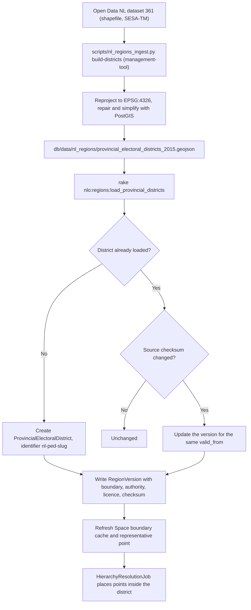

# Typed regions, versions and identifiers

Host-side first cut (to be backported to Community Engine). Plan and data sources: management-tool
`docs/nl-regions-electoral-census-assessment-20261019.md`.



- `Region` keeps one identity across redistributions. `NewfoundlandLabradorOnline::ProvincialElectoralDistrict` is an STI
  subtype (identifier `nl-ped-<slug>`).
- `RegionVersion` (`region_versions`) stores the name and boundary in force over a date range. `region.version_on(date)`
  and `region.current_version` resolve it. The region's `Space#boundary` caches the current version for placement.
- `RegionIdentifier` (`region_identifiers`) holds external ids, unique per scheme (`nlo_ped`, `statcan_dguid`,
  `statcan_feduid`, `wikidata`, `osm_relation`, `elections_nl`).

## Loading the 40 districts (2015 map)

`bin/rails nlo:regions:load_provincial_districts` reads `db/data/nl_regions/provincial_electoral_districts_2015.geojson`
(Open Data NL dataset 361, Open Government Licence; simplified to about 70 m). Idempotent: districts match on their
`nlo_ped` identifier, and a version's boundary is rewritten only when the packet's `source_sha256` changes.

The packet is built by management-tool `scripts/nl_regions_ingest.py` (`fetch-districts`, `build-districts`).

## Public district pages

- `GET /:locale/districts` lists the districts; `GET /:locale/districts/:id` (for example `/en/districts/nl-ped-corner-brook`)
  shows the current boundary on the shared map, facts and source, settlements whose point falls inside the boundary, the
  history of names and boundaries, and external identifiers. Both are public; policy is `ProvincialElectoralDistrictPolicy`.
- Stable DOM ids are asserted in `spec/dom_contracts/district_page_spec.rb`.
- Screenshots (desktop and mobile, plain and annotated) are captured with
  `./bin/dc-run env RUN_DOCS_SCREENSHOTS=1 bundle exec rspec spec/docs_screenshots/districts_spec.rb` into `docs/screenshots/`.




## Diagrams

Sources in `docs/diagrams/source`, exports in `docs/diagrams/exports` (see `docs/diagrams/README.md`).





## Elections and members (phase 2)

Provincial general-election results for 2015, 2019, 2021 and 2025 load from `db/data/nl_regions/provincial_election_results.json`
(built by management-tool `scripts/nl_elections_ingest.py` from Wikipedia, with source URL, revision id and checksum on
each election; cross-check against Elections NL before relying on a figure).

```bash
./bin/dc-run bin/rails nlo:regions:load_provincial_elections   # idempotent; run after load_provincial_districts
```

- `elections` holds one row per general election; `electoral_contests` one per district per election;
  `candidacies` the candidates (names only).
- Only elected candidates become `BetterTogether::Person` records (identifier `nl-mha-<name>`), joined to the district
  and election cycle by `elected_terms`. A term ends when the next election's winner takes the seat.
- By-elections and mid-term resignations are not loaded yet.

### Parties, brand colours and affiliation over time

Parties load first from `db/data/nl_regions/provincial_parties.json` (built by management-tool
`scripts/nl_parties_ingest.py`; logos in `db/data/nl_regions/party_logos/`):

```bash
./bin/dc-run bin/rails nlo:regions:load_political_parties   # idempotent; run before load_provincial_elections
```

- `political_parties` are scoped by `jurisdiction` (`provincial-nl`). Provincial and federal parties are separate
  entities even when they share a name: the provincial Liberals and NDP are not their federal counterparts. The
  association between them (same organisation, affiliated, or unrelated) is modelled with the federal electoral work.
- The brand colour is derived from the logo (SVG fills or dominant saturated pixels), falling back to Wikipedia's
  chart colour, then a neutral grey; `color_source` records which. Logo licence and source are stored per party.
  The PC and NL Alliance logos are Wikipedia fair-use (non-free): confirm permission before public production use.
- `party_memberships` are dated rows (`started_on`, `ended_on`, start and end reasons such as `elected`,
  `floor_crossing`) so a member can change party mid-term. The loader seeds one per run of terms in the party elected;
  `ElectedTerm#party_on(date)` answers from the membership in force, else the party elected.
- The districts map fills each district in its sitting member's party colour (no member: grey) with a legend and
  seat counts; the district page shows the member's party swatch and logo.
- Not yet sourced: dated floor crossings (Wikidata party membership has no dates; record them as memberships).
- Diagram: `docs/diagrams/exports/png/nlo_elections_schema_erd.png`.
